# 咻咻勇者 1.3.67 启动初始化链路

> 目标包：`com.xxyz.sdc` 1.3.67（versionCode 103067，TapTap 渠道原版，14 dex，无壳）
> 底包只读来源：`/tmp/xxyz/base.apk`（526,248,374 B，md5 `eaa30fbfc5edc302f6e5a0cbc12009ae`，设备 serial `f9a116a2` 只读拉取）
> JS 抽包：`/tmp/xxyz/js/`（逐文件）；主 bundle `/tmp/xxyz/js/assets__assets__scripts__index.js`（APK 内 `assets/scripts/index.js`），热更副本 `/tmp/xxyz/hu_scripts_index.js`
> 本文所有结论均标注证据来源：**【APK】**=包内文件静态证据、**【log】**=运行期 logcat 实测、**【APK+log】**=两者互证。
> 运行期样本：PID 20027，2026-10-03 01:13:20–01:13:22（本机装配有星光菜单的包；hook 行为不影响链路本身）。

---

## 0. 概览时序图

```mermaid
flowchart TD
  A0["zygote fork → ActivityThread.handleBindApplication"] --> A1["官方 Application.attachBaseContext()<br/>HeroUSDKApplication → herosdk.SdkApplication → ultrasdk.SdkApplication<br/>MultiDex.install / CompatHelper.init / CloudClientSdk / PluginUtils.initPlugin"]
  A1 --> A2["ContentProvider.onCreate() 轮次<br/>★ com.starry.magic.StarryInitProvider (initOrder=100)<br/>SignSpoof.install → System.loadLibrary(libstarry_magic.so)<br/>JNI_OnLoad → RegisterNatives 19/19 → MenuService 前台服务<br/>（另有 30 个官方 provider，ApkChannelFileProvider initOrder=999999 最后）"]
  A2 --> A3["官方 Application.onCreate()<br/>i0.X().e1 / invokePlugin(ON_APPLICATION_CREATE)<br/>DataAnalyzeUtils.startDataAnalyze / HttpApi.preInit"]
  A3 --> A4["HeroUSDKSplashActivity (LAUNCHER, 全包唯一)<br/>onSplashStop() 只此一处覆写"]
  A4 --> A5["com.ultrasdk.SdkSplashActivity#onCreate<br/>n()→doSplashInit()→HttpApi.init(ctx,ISdkListener)<br/>k()→[i0.X().U0()]→checkAgreementMsg()（隐私协议门）<br/>l()→post{ onSplashStop(); startActivity(com.cocos.game.AppActivity) }"]
  A5 --> A6["com.cocos.game.AppActivity<br/>libcocos.so 初始化 → 执行 assets/main.js（jsb 侧）"]
  A6 --> B1["main.js: 热更搜索路径预处理<br/>localStorage[HotUpdateSearchPaths] / HotUpdateBasePackageVersion<br/>jsb.fileUtils.setSearchPaths(blackjack-remote-asset)"]
  B1 --> B2["require('src/system.bundle.js') → SystemJS<br/>读 src/import-map.json = {cc: ./cocos-js/cc.js}<br/>System.warmup(...)"]
  B2 --> B3["System.import('./application.js') → new Application()<br/>System.import('cc') → require('jsb-adapter/engine-adapter.js')<br/>application.init(cc) → application.start()"]
  B3 --> B4["cc.game.init({settingsPath:'src/settings.json'}) → cc.game.run()<br/>CocosEngine 3.8.8，launchScene = db://assets/start/start.scene（属 main bundle）"]
  B4 --> C1["main bundle 脚本 bundle://main/_virtual/Start.ts<br/>onLoad: 'start onLoad ==== ' + addPersistRootNode(uiCanvas) + initSize()"]
  C1 --> C2["Start.start(): 'start start ==== '<br/>loadAssetBundles(['scripts']) → assetManager.loadBundle('scripts')<br/>'finish load scripts bundles,used time %s'"]
  C2 --> C3["scripts bundle 12.5MB 文本经 se::ScriptEngine::evalString 评估<br/>★ 星光 hook 在此改写文本（前缀注入 + 挂点替换）"]
  C3 --> C4["loadScriptsAndCreateGameManager():<br/>Render2DPriority(8) / requestBundleVersionInfo()（真机 Android 直返 true）<br/>new Node('GameManager') + addComponent('GameManager') → await i.ready"]
  C4 --> C5["GameManager.onLoad(): Logger.Init(Error|Warn)<br/>registerManagers() → preInit() → init()"]
  C5 --> C6["preInit(): 逐 manager preInit + preInitCallback 驱动 Start 进度条<br/>SoundManager.initComponents(node)<br/>★ if(!isTrialPlayEntry) loadLoginScene() → SceneManager.changeToScene(SceneId.Login)"]
  C6 --> C7["init(): 逐 manager init → 0.6 → 0.8<br/>DoraemonAssetsPreloadManager.gameInit() → beforeLoginInit()<br/>→ 进度 1、_inited=true、resolve ready"]
  C7 --> D1["SceneRouter.routes: SceneId.Login → rootWindowId UIViewId.LoginPage(=2)<br/>LoginPage.ts 创建（deps 含 LoginModule/PlatformSDK/HotUpdate/UIManager）"]
  D1 --> D2["登录页阶段：Hero SDK 回调挂载（AndroidSDK.registerAndroidCallback）<br/>热更检查入口（HotUpdate.ts）<br/>玩家点击/自动触发 HeroSdk.login() → Java 侧 HeroUSDKCocosBridge.login"]
  D2 --> D3["【可选】TapTap 三方登录分支<br/>ultrasdk 服务端 conf 中 thirdLogin.taptap.enabled=0 ⇒ 本包默认不走 TapTap SSO"]
```



---

## 1. Android 侧：进程 → provider → Application → Splash

### 1.1 启动入口与组件【APK】
- `application android:name=com.hero.herousdkcocos.HeroUSDKApplication`，`appComponentFactory=androidx.core.app.CoreComponentFactory`，`targetSdk 34 / minSdk 24 / compileSdk 34`，14 个 dex。
- LAUNCHER 全包仅 1 个：`com.hero.herousdkcocos.HeroUSDKSplashActivity`（exported=true，launchMode=2，orientation=1，theme=`@0x01030007`）。
- 主游戏 Activity：`com.cocos.game.AppActivity`（exported=true，launchMode=2）。
- ContentProvider 共 30 个（`ApkChannelFileProvider` initOrder=999999 收尾）。
- 详细全表见 `10_docs/咻咻勇者/manifest_全量表_1.3.67.md`。

### 1.2 官方 Application 链【APK】
`HeroUSDKApplication`(23 行，仅 super) → `com.herosdk.SdkApplication`(68 行，仅 `adapterChannelApi()`) → `com.ultrasdk.SdkApplication`（★ 真正主体）→ `com.herosdk.channel.hero.ChannelApplication` → `com.ultrasdk.channel.ultra.ChannelApplication` → `com.ultrasdk.official.activity.BaseApplication`（super=`android.app.Application`，无 attachBaseContext/onCreate）。

- `ultrasdk.SdkApplication#attachBaseContext`：`MultiDex.install → CompatHelper.init → z.w() → x.m().v(ctx) → a.a().b(this) → adapterChannelApi → i0.X().S1/j1 → PluginUtils.initPlugin → invokePlugin(ON_APPLICATION_ATTACH)`。
- `ultrasdk.SdkApplication#onCreate`：`i0.X().e1 → invokePlugin(ON_APPLICATION_CREATE) → DataAnalyzeUtils.startDataAnalyze → HttpApi.preInit`。
- **结论：TapSDK 初始化与隐私协议都不在 Application 层**（否证）。

### 1.3 星光插件的插入位（ContentProvider 轮次）【APK+log】
- 装配包在 manifest 增加：provider `com.starry.magic.StarryInitProvider`（authorities `<pkg>.starryinit`，initOrder=100，exported=false）+ service `com.starry.magic.menu.MenuService`（`foregroundServiceType=specialUse`）+ 三个权限（`SYSTEM_ALERT_WINDOW`/`FOREGROUND_SERVICE`/`FOREGROUND_SERVICE_SPECIAL_USE`）；**不替换官方 Application**。
- 框架顺序为 `attachBaseContext → ContentProvider.onCreate → Application.onCreate`；运行期同毫秒时间戳佐证【log 01:13:20.331】：
  - `I/StarrySignSpoof: installed pkgs=[…, com.xxyz.sdc, …]`
  - `I/StarryNativeLoad: loaded apk so via loadLibrary`
  - `I/ModBridge: native via StarryNativeLoad: loadLibrary(starry_magic)`
  - `I/StarryMagic: [桥接] RegisterNatives 19/19 全部成功`
  - `I/StarryMagic: 星光魔法 MOD 菜单已加载 (MainModern tag=xxyz)`
  - `I/StarryBridgeTest: === 桥接自检结束: PASS=15 FAIL=0 === ✓`
- 之后才进入 Cocos 侧：`D/Cocos … start onLoad ==== `【log 01:13:21.074】。

### 1.4 Splash 阶段（不会弹登录界面）【APK+log】
`HeroUSDKSplashActivity` 仅覆写 `onSplashStop()`；`com.ultrasdk.SdkSplashActivity#onCreate` 顺序：
`n()` → `doSplashInit()` → `HttpApi.init(ctx, ISdkListener)`（平台初始化网络请求）→ `k()` → `[i0.X().U0()]` → `checkAgreementMsg()`（隐私协议弹窗 `com.ultrasdk.dialog.w/.x`）→ `l()` → `post{ onSplashStop(); startActivity(com.cocos.game.AppActivity) }`。
【log 01:13:20.103】`D/WindowManager: NFW_setClientVisible … com.hero.herousdkcocos.HeroUSDKSplashActivity`；`I/ActivityManager: Start proc 20027:com.xxyz.sdc/u0a978 for top-activity {…HeroUSDKSplashActivity}`。

### 1.5 Hero SDK 与三方登录配置【log】
`D/ultrasdk` 侧服务端配置（`https://sdk-api.yingxiong.com/sdrsrv/... conf`）关键字段：`usdkGid=2334`、`publishName=英雄游戏`、`logoutURL=https://www.zealshow.com/logout`，`thirdLogin` 中 **`"taptap":{"enabled":0}`**（其余 qq/wechat/douyin 等亦为 0，仅 `phone=1`/`phoneQK=1`/`sina=1`）。
SDK 侧回调序列（实测）：`D/ultrasdk: getThirdTapTap` → `D/ultrasdk: request result:{…}` → `E/cocos.herousdk.support: login(Call)`（`sendAsync class=…HeroUSDKCocosBridge method=call json={"funType":"2"}`）。
⇒ **本包默认登录走 Hero SDK 账号体系，TapTap 三方通道未启用**（TapTap 相关 patch 属于「改签后防 SSO 失败」的保险，不影响首次进入登录页）。

---

## 2. Cocos 引擎侧引导（main.js → application.js → settings.json）

### 2.1 `assets/main.js`【APK】
- 尺寸 7,071 B（抽包 `/tmp/xxyz/js/assets__main.js`）。
- 首段：热更搜索路径预处理。键 `HotUpdateSearchPaths` / `HotUpdateBasePackageVersion`；热更目录 = `jsb.fileUtils.getWritablePath() + 'blackjack-remote-asset'`；`shouldClearStaleHotUpdate()` 用内置 `project.manifest` 版本 vs 存储 `project.manifest` 版本做 `cmpVersion` 比较，内置更新则 `clearHotUpdateStorage()`；否则 `jsb.fileUtils.setSearchPaths(paths)` 并把 `_temp/` 中文件 rename 归位。日志串：`[HotUpdate] Base package version changed, clear hot update storage.` / `[HotUpdate] APK manifest newer, clear hot update storage.` / `[HotUpdate] No base package version recorded, clear legacy hot update storage.`
- 之后：`window.self = window; require("src/system.bundle.js");` → 读 `src/import-map.json` → `System.warmup({importMap, importMapUrl:'src/import-map.json', defaultHandler: url => require(url)});` → `System.import('./application.js')` → `new Application()` → `System.import('cc')` → `require('jsb-adapter/engine-adapter.js')` → `application.init(cc)` → `application.start()`；失败走 `console.error(err.toString() + ', stack: ' + err.stack)`。

### 2.2 `assets/application.js`【APK】
1,269 B。`class Application { settingsPath = 'src/settings.json'; showFPS = false; }`；`init(engine)` 注册 `cc.game.onPostBaseInitDelegate / onPostSubsystemInitDelegate`；`start()` → `cc.game.init({ debugMode: cc.DebugMode.ERROR, settingsPath, overrideSettings:{ profiling:{ showFPS:false } } }).then(() => cc.game.run())`。

### 2.3 `assets/src/settings.json`【APK】
- `"CocosEngine":"3.8.8"`。
- `launch.launchScene = db://assets/start/start.scene`。
- `assets.projectBundles = [internal, scripts, resources, main, login, acting, behaviorTree, bundle, caseNote, desc, mainland, mainlandRoom, skill, unpackDesc]`（14 个）。
- `assets.preloadBundles = [resources, main]` **重复 26 次**（构建产物特征，非手写；见未证实项 #5）。
- `assets.server = ""`、`assets.bundleVers = {}`、`assets.subpackages = []`、`scripting.scriptPackages = []`、`plugins.jsList = []`。
- `assets/import-map.json`（37 B）= `{"imports":{"cc":"./cocos-js/cc.js"}}`。

### 2.4 每个 bundle 的脚本文件形态【APK】
`assets/assets/<bundle>/index.js`：绝大多数是空壳，如 `assets/assets/login/index.js`（603 B）=
`System.register("bundle://login/_virtual/login",[],(function(){return{execute:function(){}}}));` + 一段 `virtual:///prerequisite-imports/<name>` 的包装注册。
`internal`（8,903 B）与 `main`（66,097 B）、`scripts`（12,507,685 B）是实际有内容的三个。

### 2.5 启动场景与其脚本【APK+log】
- 启动场景归属：`assets/assets/main/cc.config.json`（738 B）→ `"deps":["resources"]`、`"scenes":{"db://assets/start/start.scene":0}`、`"hasPreloadScript":true`。⇒ **`start.scene` 在 main bundle**。
- main bundle 脚本模块（8 个）：`bundle://main/_virtual/{cjs-loader.mjs, js-calendar-converter.js(+mjs 包装), main, rollupPluginModLoBabelHelpers.js, StandaloneWxDirectBoot.ts, Start.ts, TrialPlayEntry.ts}`；其中 `bundle://main/_virtual/main`（220 chars）deps 指向后四个，`execute:function(){}`（聚合入口）。
- **`bundle://main/_virtual/Start.ts`（6,075 chars）是启动场景组件**，关键片段：
  - `onLoad(){console.log("start onLoad ==== ",c.getTotalFrames(),u.totalTime/1e3),c.addPersistRootNode(this.uiCanvas),this.initSize()}`；`initSize()` 内 `h.setDesignResolutionSize(1080, s, ResolutionPolicy.SHOW_ALL)`（基准 1080×1920 宽高比换算，上限 2400）。
  - `async start(){ console.log("start start ==== ",…); const e=u.totalTime, t=w.resolveConfig(); this.setProgress(.5,!0,"初始化中：{progress}%"); … if(t){ await this.loadAssetBundles([t.scriptsBundle,t.resBundle]); const r=this.loadScriptsAndCreateGameManager(t,s); w.loadScene(r,s,t) } else { await this.loadAssetBundles(["scripts"]); …; await this.loadScriptsAndCreateGameManager(null,s) } }`
  - `loadScriptsAndCreateGameManager(e,t)`：`await this.loadOneBundle("scripts")` → uiCanvas 有效性检查（失败抛 `uiCanvas invalid after scripts loaded`）→ `t.addComponent("Render2DPriority").setRenderPriority(8)` → `const r = await this.requestBundleVersionInfo()` → `new Node("GameManager")` → `scene.addChild` → `addComponent("GameManager")` → `l.isTrialPlayEntry=!!e`（`GameManager.trialPlay`）→ `i.bundleVerResult=r` → `i.preInitCallback = e => this.setProgress(.5*e+.5,false,"初始化中：{progress}%")` → `await i.ready`。
  - `loadOneBundle(e)` = `new Promise(...) assetManager.loadBundle(e, cb) ...)`；`loadAssetBundles(list)` 顺序 await。
  - `requestBundleVersionInfo()`：仅当 `wx`/`tt`/`qg` 存在时才 POST `https://sgame-pro.yxhyu.com/clientversion/wx`（body `{version:"1.3.67"}`，最多重试 3 次，间隔 500ms×n）；真机 Android 走 `void 0===s&&!r` 分支 **直接 `return true`**。
  - 进度条由 `lateUpdate` 驱动（`progressBarSprite.fillRange`、`progressBarText.string`）。
- 【log 01:13:21.074 / 01:13:21.086 / 01:13:22.281】逐条对应：
  `D/Cocos: 01:13:21 [DEBUG]: JS: start onLoad ====  5 0.38765000000000005`
  `D/Cocos: 01:13:21 [DEBUG]: JS: start start ====  5 0.011147999999999967`
  `D/Cocos: 01:13:22 [DEBUG]: JS: finish load scripts bundles,used time 1.1944280000000003`
  （同一 pid 更早一次运行 01:05:24/01:05:25 亦同形，`used time 1.2139140000000002`。）

---

## 3. 主 bundle（scripts）被 evalString 执行

- 【APK】`assets/assets/scripts/index.js` 尺寸 **12,507,685 B**；按字符读入为 **12,401,371**（差值来自中文/多字节字符，非截断）；`System.register` 出现 **2,680** 次，解析出 **2,679** 个模块 id，**全部**前缀 `bundle://scripts/_virtual/`；`register` 全名示例：首 `bundle://scripts/_virtual/00000_00000_def_interop_pb.ts`、末 `bundle://scripts/_virtual/ZombieSuperRewardReviewPopup.ts`。
- 【APK】入口聚合模块 `bundle://scripts/_virtual/scripts`（81,956 chars）依赖 **2,545** 项、`execute:function(){}` 空体 ⇒ 形态上是「导入即评估整包」的聚合入口（引擎侧触发点未证实，见未证实项 #1）。
- 【log】该 12.5MB 文本确实经 `se::ScriptEngine::evalString` 评估：
  `Mod_Menu: [Xxyz] hooked se::evalString @0x… rva=0xC58B6C insn=0xD10503FF`、
  `Mod_Menu: [Xxyz] logic splice #1 tier=1 len 13333871->13336088 file=assets/scripts/index.js`、
  `I/Xxyz: [Xxyz] js inject alive (1=mul 2=inv)`。
- **重要事实：运行期被评估的是「热更版」bundle，而非 APK 内那一份**。`len 13333871` 与热更副本 `/tmp/xxyz/hu_scripts_index.js`（13,333,871 B）完全一致，而 APK 内那份只有 12,507,685 B ⇒ 热更（`blackjack-remote-asset`）已把 `assets/scripts/index.js` 换成 CDN 下发的版本。两版锚点计数实测一致：

| 版本 | 字节 | 字符 | `System.register` 数 | 锚点A `get flag(){…}get value(){…}` | 锚点B `get value(){…}` | TX 锚点 | RX 锚点 | `bundle://scripts/_virtual/` |
|---|---|---|---|---|---|---|---|---|
| APK 内（`assets/scripts/index.js`） | 12,507,685 | 12,401,371 | 2,679 | **1** | 2 | 1 | 1 | 2,680 |
| 热更版（`/tmp/xxyz/hu_scripts_index.js`） | 13,333,871 | 13,215,229 | 2,828 | **1** | 2 | 1 | 1 | 2,829 |

⇒ 同一套注入（前缀 + 挂点替换）对「包内版」与「热更版」都成立【APK+log】。

- 热更来源：Android 侧 `assets/version.manifest` → `https://cdn-joker.shyxhy.com/s1/android/1.3.67.29/`（**注意 ≠ APK 的 1.3.67**，第 4 段为热更序号 29）。

---

## 4. 到登录界面之前的模块闭包（scripts bundle）

### 4.1 管理器（GameManager）初始化顺序【APK】
`bundle://scripts/_virtual/GameManager.ts`（3,828 chars）：

- 依赖：`cc, ./UIManager.ts, ./ModuleManager.ts, ./Logger2.ts, ./SceneManager.ts, ./SceneId.ts, ./index4.ts, ./PromiseTaskManager.ts, ./NetworkManager.ts, ./LocalizedManager.ts, ./BattleManager.ts, ./SoundManager.ts, ./BehaviorManager.ts, ./DoraemonAssets.ts, ./DoraemonAssetsPreloadManager.ts, ./NodeComponentPoolManager.ts, ./AssetPoolManager.ts, ./TrialPlayBridge.ts`。
- `registerManagers()` 顺序数组 = `[m, v, w, u, _, M, d, g, f, l, y, p, P, L]`，按导入绑定对应：
  1. `PromiseTaskManager`
  2. `DoraemonAssets`
  3. `DoraemonAssetsPreloadManager`
  4. `DescManager`
  5. `LocalizedManager`
  6. `NetworkManager`
  7. `SceneManager`
  8. `ModuleManager`
  9. `BattleManager`
  10. `UIManager`
  11. `Logger2`(default)
  12. `SoundManager`
  13. `AssetPoolManager`
  14. `NodeComponentPoolManager`
  （每个 `getInstance()` 后，`DescManager` 额外 `setJsonLoadHandle(loadDescJsonHandle)`。）
- `onLoad()`：重复实例检查（warn `GameManager has created ,can't create again`）→ `Logger.Init({level: Error|Warn, type: Framework|Module, logTime:true})` → `director.addPersistRootNode(this.node)` → `await preInit()` → `await init()`。
  ⚠️ 因为 `Logger.Init` 把级别压到 `Error|Warn`，此后 `debugFramework/debugView` 的日志**不会**出现在 logcat（`warnFramework` 会）。
- `preInit()`：`for manager: await n.preInit(); preInitCallback(i/len)`（每次超 100ms 就 `PromiseTaskManager.getInstance().yield()`）→ `SoundManager.getInstance().initComponents(this.node)` → `preInitCallback(1)` → **`this.trialPlay.isTrialPlayEntry || await this.loadLoginScene()`**；`loadLoginScene(){ await SceneManager.getInstance().changeToScene(SceneId.Login) }`。
- `init()`：`for manager: await a.init()`（`_progress=(i+1)/len*0.6`）→ `_progress=0.8` → `await DoraemonAssetsPreloadManager.getInstance().gameInit()` → 日志 `start before login assets load` → `beforeLoginInit().then(()=>{_progress=1; _inited=true; …'finish before login assets load'})` → `warnFramework("GameManager init end =================")` → `_readyResolve()`（Start.ts 的 `await i.ready` 在此解除）。

### 4.2 场景/窗口路由【APK】
- `bundle://scripts/_virtual/SceneRouter.ts`（543 chars）：
  `class SceneRouter { static getSceneRoute(e){…} }`；`routes = [{sceneId: SceneId.Login, rootWindowId: UIViewId.LoginPage}, {sceneId: SceneId.Game, rootWindowId: UIViewId.HomePage}]`。
- `bundle://scripts/_virtual/UIViewId.ts`（26,728 chars）枚举：`None=0, PageIdStart=1, LoginPage=2, HomePage=3, BattlePage=4, SkillPage=5, AttendantPage=6, RoleEquipShopPage=8, AvatarPage=9, …`。
⇒ 到登录界面 = `SceneId.Login` 场景 + 根窗口 `UIViewId.LoginPage(2)`。

### 4.3 模块（Module）层注册与实例化时机【APK】
- `bundle://scripts/_virtual/ModuleRegister.ts`（595 chars）：`registerModule(resident=false, executionOrder=0)` 返回类装饰器，把 `{moduleClass, executionOrder}` 塞进 `ModuleManagerRegister.modules`（非驻留）或 `.residentModules`（驻留）；`ModuleExecutionOrder = { SystemUnlockModule:-2, QuestModule:-1, Default:0 }`。全包 `registerModule` 出现 **69** 次。
- `bundle://scripts/_virtual/ModuleManager.ts`（1,975 chars）：
  - `preInit()`：`residentModules.sort(executionOrder)` → `new e.moduleClass; t.init()`（**驻留模块在登录前就实例化**）。
  - `doGameConnect(e)`：`modules.sort(executionOrder)` → `new e.moduleClass; this._modules.push(t); t.init()`，随后对 `BaseModuleWithMessage` 子类调 `onGameConnect(e)` ⇒ **非驻留模块（含 LoginModule/PlayerModule 等）要等「连服」之后才实例化**。
  - `doGameLogOut()`：全部 `uninit()` 并清空 `_modules`。

### 4.4 登录页及其依赖【APK】
- `bundle://scripts/_virtual/LoginPage.ts`（22,863 chars）deps 含：`rollupPluginModLoBabelHelpers.js, cc, Logger2, UIPage, LoginModule, ModuleManager, SoundManager, LoginEventSystem, PlatformSDK, HotUpdate, Context, ReportModule, ReportConst, UIManager, UIWindowOpenParam, UIViewId, index.ts, TimeFormat, UIViewPath, PromiseTaskManager, GameManager, StorageManager, StorageKey, LoginNoticePopup, CommonConfirmPopup, CommonUtils, LoginRestartPopup, CommonTitleDescPopup, 00000_00000_def_pb, 01201_01300_account_pb`。
  ⇒ 登录页一创建即持有 **HotUpdate**（热更检查入口）与 **PlatformSDK**（Hero SDK 包装）。
- `bundle://scripts/_virtual/PlatformSDK.ts` 是 `bundle://scripts/_virtual/AndroidSDK.ts`（13,134 chars）的**唯一导入方**。`AndroidSDK` 关键片段：
  - `getInstance()`：单例 + `registerAndroidCallback()`。
  - `registerAndroidCallback(){ A.isAndroidAppGame() && (!this._hasRegister && (this._hasRegister=!0, this.mountHeroSdkCallbacks(), this.mountBuAdSdkCallbacks(), this.mountBdcCallbacks(), o.getInstance().RequestProtocolAgree(), o.getInstance().Init())) }`
  - `mountHeroSdkCallbacks()`：`OnProtocolAgreeCallBack=this.onHeroProtocolAgree, OnInitCallBack=this.onHeroInit, OnLoginStateCallBack=this.onHeroLoginState, OnSwitchAccountStateCallBack=this.onHeroSwitchAccount, …`
  - `tryStartSdkLogin(){ this._pendingSdkLogin && this._heroProtocolAgreed && this._heroSdkInitSucceeded && (this._pendingSdkLogin=!1, o.getInstance().Login()) }`
  - 另有 `IOSSDK.ts` / `HarmonySDK.ts` 同构实现（本包 Android 分支）。
- JS 侧 Hero 回调壳：`bundle://scripts/_virtual/herousdk.ts` 包装 `__HeroUSDK_onNativeCallback` 与 `HeroSdk.OnMessageCall`。

### 4.5 登录页之前的「游戏逻辑大包」【APK】
- `bundle://scripts/_virtual/index.js`（1,113,476 chars）是战斗/角色逻辑聚合模块，导出：
  `t({ Logger: void 0, createBlockWithShape: Pm, initialize: async function(t,e=!0,i){ e||mn.setLogLevel("error"); Qc.getInstance().setReader(t), await Qc.getInstance().init(), await tv.getInstance().init(i), mn.debug("Main","战斗逻辑完成配置初始化") } })`。
- 本项目的伤害挂点就落在该模块内（见 §5）：`get flag(){return this._flag}get value(){return this._isDirty&&this.calculate(),this._value}`（全包唯一），且同模块有 `isFriendPlayerRole(){return(32&this.roleTag)>0&&1==this.teamType&&1==this.roleType}` ⇒ JS 侧友方判定字段 `teamType/roleType/roleTag` 与该出口同源。
- 网络收发锚点宿主 `bundle://scripts/_virtual/NetworkNode.ts`（唯一）：
  `sendMessage(e){var s;if(null==(s=this._session)||!s.sendMessage(e))return!1;const t=e.constructor.msgid;return this._service.recordSentMe…`
  `emitMessages(e){this._isEmitingMessage=!0;for(let s=0;s<e.length;s++){const i=e[s],a=i.constructor.msgid;…`

### 4.6 热更检查【APK】
`bundle://scripts/_virtual/HotUpdate.ts`（7,448 chars）：基于 `native.EventAssetsManager`（jsb 热更）。
- 事件枚举：`HotUpdateEvent{ None=0, IsLatestVersion=1, NeedUpdate=2, CheckVersionError=3, UpdateProgress=4, UpdateFinish=5, UpdateFailNeedRetry=6, UpdateError=7 }`。
- 类字段：`manifestUrl/_storagePath/_am/_checkListener/_updateListener/failCount/_updating/_canRetry/versionCompareHandle`。
- `checkCb(e)` 分支日志：`No local manifest file found, hot update skipped.` / `Fail to download manifest file, hot update skipped.` / `Already up to date with the latest remote version.` 等。
- 静态可见范围内**未见签名/哈希强制校验**（仅有清单 + 版本比较），细节未逐行读完 ⇒ 列为未证实项 #3。

---

## 5. 可注入点 → 效果对照表

| # | 注入位置（指纹 / 宿主模块） | 时机 | 可达成效果 | 本项目 |
|---|---|---|---|---|
| ① | **主 bundle 头部前缀注入**；指纹 `bundle://scripts/_virtual/`（APK 版 2,680 次 / 热更版 2,829 次）；native 侧常量 `kFpModules`、幂等标记 `starry_xxyz_v1` | 每次 `evalString` 命中主 bundle 文本时，**整包评估之前** | 定义全局助手（`globalThis.__xxyzV/__xxyzTX/__xxyzRX`）、建立 JS↔Java 状态通道、实现「JS 自愈」替换体 | ✅ 已用（`Games/XxyzPatchJs.h` → `kXxyzPatchJs`）【APK+log：`logic splice #1 tier=1 …`】 |
| ② | **`HurtData.get value()` 出口包装**；锚点 A `get flag(){return this._flag}get value(){return this._isDirty&&this.calculate(),this._value}`（宿主 `bundle://scripts/_virtual/index.js`，**count==1**）；锚点 B 裸 `get value(){return this._isDirty&&this.calculate(),this._value}`（count==2 = HurtData + HealData，靠 JS 侧 `typeof h.damageType === "undefined"` 过滤治疗） | 与 ① 同批（文本改写），首次伤害结算前 | **伤害倍率**（`Slider_伤害倍率`，VAL 索引 1）、**无敌**（`Toggle_无敌`，RET 索引 2）；友方判定用 `teamType===1` / `r.isFriendPlayerRole()` | ✅ 已用（命中数不等于 1 时拒绝局部改写：`anchor A hit %d times (expect 1); refuse partial patch`） |
| ③ | **`NetworkNode.sendMessage` 出口**；锚点 `sendMessage(e){var s;if(null==(s=this._session)||!s.sendMessage(e))return!1;`（宿主 `bundle://scripts/_virtual/NetworkNode.ts`，count==1） | 首次上行前 | 出站报文旁路/观测（`__xxyzTX`） | ✅ 已用（miss 时打印 `net hook anchor miss tx=… rx=…; exp bypass levers inactive`） |
| ④ | **`NetworkNode.emitMessages` 出口**；锚点 `emitMessages(e){this._isEmitingMessage=!0;`（同模块，count==1） | 首次入站分发前 | 入站报文旁路/观测（`__xxyzRX`，可读 `msgid`） | ✅ 已用 |
| ⑤ | **JS↔Java 状态通道**：`jsb.reflection.callStaticMethod("com.starry.magic.cocos.XxyzHooks","getRet"/"getVal"/"logStatus", …)`（`R()/V()/J()` 包装，`(I)Z`/`(I)I`/`(Ljava/lang/String;)V`） | 任意 JS 时机 | 读菜单开关/滑块值、上报战况计数（`[Xxyz] dmg hit inv=… mul=… raw=… skip=…`，t===1 或每 +200 次上报） | ✅ 已用 |
| ⑥ | `AndroidSDK` 回调/登录触发：`registerAndroidCallback()`、`mountHeroSdkCallbacks()`、`tryStartSdkLogin()`、`onHeroProtocolAgree/onHeroInit/onHeroLoginState`（宿主 `bundle://scripts/_virtual/AndroidSDK.ts`，唯一导入方 `PlatformSDK.ts`） | Hero SDK 初始化前后、登录页阶段 | 伪造/跳过隐私协议回调、免点击自动触发 Hero 登录（`o.getInstance().Login()`）、接管登出/切号回调 | ❌ 未用（本包 `thirdLogin.taptap.enabled=0`，实测登录经 Hero SDK 完成） |
| ⑦ | **场景路由**：`GameManager.loadLoginScene()` → `SceneManager.changeToScene(SceneId.Login)`；`SceneRouter.routes`（Login→`UIViewId.LoginPage=2`，Game→`HomePage=3`） | 场景切换时 | 直接改跳目标场景/根窗口（绕过登录页或直进主页，服务端仍会校验） | ❌ 未用 |
| ⑧ | `LoginPage.ts`（22,863 chars；deps 含 `LoginModule/PlatformSDK/HotUpdate/UIManager/LoginEventSystem/LoginQRCodePopup…`） | 登录页创建时 | 注入自定义按钮/自动登录/拦截热更弹窗；也可在此层改登录 UI 分支 | ❌ 未用 |
| ⑨ | `HotUpdate.ts`（`checkCb`/`manifestUrl`/`HotUpdateEvent`，走 `native.EventAssetsManager`） | 登录页阶段热更检查 | 固定走 `IsLatestVersion`、跳过下载、绕过清单/版本比对 | ❌ 未用 |
| ⑩ | Java 侧（非 JS）：`HeroUSDKCocosBridge.login`（`s_classes3/.../HeroUSDKCocosBridge.java:805-811`）、`ultra.User.login(Activity,Z)`（`UltraSDKManager.showLoginView(handler,0x7de,true,true)`）、`SdkSplashActivity#checkAgreementMsg` | 任意 | 跳过 LoginDialog 自绘 UI、免点隐私协议直达 `l()` | ❌ 未用 |

---

## 6. 未证实项与验证方法

| # | 未证实内容 | 现状证据 | 验证方法 |
|---|---|---|---|
| 1 | `bundle://scripts/_virtual/scripts`（deps 2,545、`execute` 空）是否由引擎在 bundle 加载时 `import`，从而评估整包 2,679 个模块 | 静态只证明「依赖聚合 + 注册」；文件尾部无任何顶层 `System.import`（全包 `System.import` 计数 0） | 在 JS 侧临时 `console.log(System.register.toString().length)` 或 hook `System.import`；也可在评估后立刻打印 `ModuleManagerRegister.modules.length`，对比包内 `registerModule` 出现次数 69 |
| 2 | 登录页之前在登录链上**实际执行**的模块子集（本文只给出 import 闭包 + manager 初始化顺序） | `GameManager.preInit/init` 的 manager 顺序、`ModuleManager` 两阶段实例化（resident 早、非 resident 等 `doGameConnect`）已证 | 在 `GameManager.preInit` 前后打印 `ModuleManagerRegister.modules.length` / `residentModules.length`；或给 `registerModule` 装饰器打时间戳 |
| 3 | JS 侧热更清单是否存在签名/哈希强制校验 | `HotUpdate.ts` 静态仅见清单 + 版本比较；未逐行读完 7,448 chars | `adb logcat \| grep -aE "HotUpdate\|manifest\|校验"`；只读 GET `https://cdn-joker.shyxhy.com/s1/android/1.3.67.29/project.manifest` 看是否含 `signature` 字段 |
| 4 | `StarryInitProvider` 与官方 `ultrasdk.SdkApplication` 在真机的**确切**先后（非同一毫秒） | 静态为框架约定 `attachBaseContext → ContentProvider.onCreate → Application.onCreate`；运行期仅同毫秒时间戳【log 01:13:20.331】 | 两端各打一行带 `System.nanoTime()` 的日志（provider onCreate / 官方 `SdkApplication.onCreate`） |
| 5 | `settings.json` 的 `preloadBundles` 为何重复 26 次、是否真的重复预加载 | 静态 JSON 事实（26 组 `resources, main`） | logcat 统计 bundle 加载次数（`loadBundle` 走 hook 或 Cocos 自身日志），或分段测量首帧耗时 |
| 6 | Hero SDK `Init()` → `OnInitCallBack` 的精确触发时刻（决定 `tryStartSdkLogin` 最早可发时间） | `AndroidSDK.tryStartSdkLogin()` 需 `_pendingSdkLogin && _heroProtocolAgreed && _heroSdkInitSucceeded` 三者同时为真 | hook `__HeroUSDK_onNativeCallback` / `HeroSdk.OnMessageCall`，打印 `funType` 与到达顺序 |
| 7 | 运行期被评估的 bundle 是热更版还是包内版，是否随每次启动变化 | 已证本次运行为热更版（`len 13333871` = `hu_scripts_index.js` 字节数）；但未验证清缓存/断网时会回退到包内版 | 对比 `logcat` 的 `logic splice #1 … len <A>-><B>`：`len=12507685` ⇒ 包内版，`len=13333871` ⇒ 热更版 |

### 常用 logcat 关键字（一次性拉全链）

```bash
adb -s f9a116a2 logcat -v time | grep -aE \
"StarrySignSpoof|StarryNativeLoad|StarryBridgeTest|Mod_Menu|Xxyz|D/Cocos|ultrasdk|herousdk|CocosJavascriptJavaBridge"
```

JS 侧关键串（均在 `D/Cocos` 标签、正文前缀 `JS: `）：
`start onLoad ==== `、`start start ==== `、`finish load scripts bundles,used time`、`finish load trial bundles,used time`、`version ==== `、`updateBundleVersions success`、`GameManager init end`（warn 级，logcat 可见）、`start before login assets load` / `finish before login assets load`（debug 级，被 `Logger.Init(Error|Warn)` 压制，**默认看不到**）、`No local manifest file found, hot update skipped.`、`Already up to date with the latest remote version.`、`Start.loadScriptsAndCreateGameManager: uiCanvas invalid`。

---

## 附录：本文用到的定位命令

```bash
# 逐 bundle 脚本/配置清单
python3 - <<'PY'
import zipfile; z=zipfile.ZipFile('/tmp/xxyz/base.apk')
for n in sorted(x for x in z.namelist() if x.startswith('assets/assets/') and x.endswith(('config.json','index.js'))):
    print(n, z.getinfo(n).file_size)
PY

# 主 bundle 模块切分（禁止整读 12MB 进上下文）
python3 - <<'PY'
import re
s=open('/tmp/xxyz/js/assets__assets__scripts__index.js',encoding='utf-8',errors='replace').read()
mods=[p[:p.find('"')] for p in re.split(r'System\.register\("',s)[1:]]
print(len(mods), mods[:2], mods[-1])
PY

# 锚点唯一性（包内版 / 热更版各跑一次）
python3 - <<'PY'
for p in ['/tmp/xxyz/js/assets__assets__scripts__index.js','/tmp/xxyz/hu_scripts_index.js']:
    s=open(p,encoding='utf-8',errors='replace').read()
    print(p, s.count('get flag(){return this._flag}get value(){return this._isDirty&&this.calculate(),this._value}'),
              s.count('sendMessage(e){var s;if(null==(s=this._session)||!s.sendMessage(e))return!1;'))
PY
```
